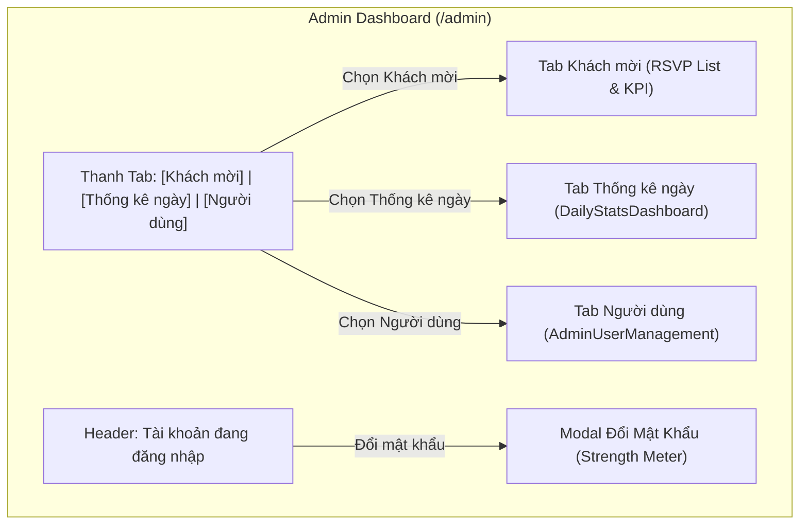

# Kế Hoạch Xây Dựng Tính Năng Quản Lý Tài Khoản Người Dùng (Buổi 5)

Tài liệu thiết kế kỹ thuật và kế hoạch triển khai tính năng quản lý tài khoản người dùng / quản trị viên cho thiệp cưới Nam & Lan.

---

## 1. Mục Tiêu & Yêu Cầu Cốt Lõi

1. **Thanh điều hướng Tab ngắn gọn**:
   - Tab 1: **"Khách mời"** (Quản trị danh sách phản hồi RSVP & Thống kê).
   - Tab 2: **"Thống kê ngày"** (Biểu đồ cột CSS thuần đọc bảng tổng hợp).
   - Tab 3: **"Người dùng"** (Quản trị tài khoản hệ thống).
2. **Hệ thống phân quyền tinh gọn (2 cấp độ)**:
   - **Admin (Quản trị viên)**: Toàn quyền xem, sửa, xoá RSVP, xuất dữ liệu, tạo và quản lý tài khoản người dùng khác.
   - **Viewer (Chỉ xem)**: Chỉ được xem danh sách khách mời và các chỉ số thống kê, không có quyền chỉnh sửa dữ liệu hay thay đổi tài khoản.
3. **Cơ chế vô hiệu hoá tạm thời (Soft Delete)**:
   - Không xoá cứng (`HARD DELETE`) bản ghi trong cơ sở dữ liệu.
   - Chuyển đổi trạng thái `active` ➔ `inactive` (vô hiệu hoá) hoặc ngược lại, đảm bảo an toàn dữ liệu lịch sử.
4. **Nút thao tác dạng Icon ngắn gọn**:
   - Sử dụng các icon tinh gọn từ `lucide-react` (kèm tooltip rõ ràng) thay cho các nút có nhãn chữ dài dòng, giúp bảng thông tin thoáng đãng, sang trọng.
5. **Tiêu chuẩn mật khẩu & Thước đo độ mạnh (Password Strength Meter)**:
   - Quy chuẩn mật khẩu khi tạo mới / đổi mật khẩu: tối thiểu 8 ký tự, bao gồm **chữ thường**, **chữ hoa**, và **ký tự đặc biệt** (`@, $, !, %, *, ?, &, #...`).
   - Thước đo hiển thị màu sắc và cấp độ trực quan: **Yếu** (Đỏ), **An toàn / Trung bình** (Vàng/Cam), **Mạnh** (Xanh rêu sang trọng).
6. **Đổi mật khẩu cá nhân**:
   - Quản trị viên đang đăng nhập có thể bấm đổi mật khẩu trực tiếp với form đo lường độ mạnh mật khẩu thời gian thực.

---

## 2. Thiết Kế Cơ Sở Dữ Liệu (Supabase Schema)

Xem script SQL chi tiết tại: [`docs/sql/02-bang-admin-users.sql`](./sql/02-bang-admin-users.sql) (hoặc file tổng [`docs/sql/00-migration-tron-goi.sql`](./sql/00-migration-tron-goi.sql)).

```sql
create table if not exists public.admin_users (
  id uuid default gen_random_uuid() primary key,
  auth_id uuid references auth.users(id) on delete set null,
  email text not null unique,
  full_name text not null,
  role text not null default 'viewer' check (role in ('admin', 'viewer')),
  status text not null default 'active' check (status in ('active', 'inactive')),
  created_at timestamp with time zone default timezone('utc'::text, now()) not null,
  updated_at timestamp with time zone default timezone('utc'::text, now()) not null
);

alter table public.admin_users enable row level security;
```

---

## 3. Kiến Trúc Luồng & Thành Phần Giao Diện


