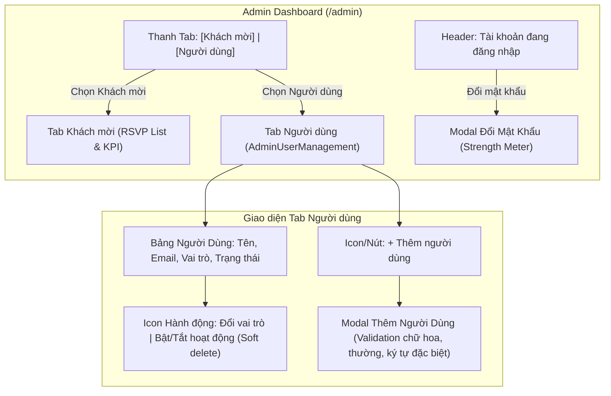

# Kế Hoạch Xây Dựng Tính Năng Quản Lý Tài Khoản Người Dùng (Đã Cập Nhật Theo Góp Ý)

Tài liệu thiết kế kỹ thuật và kế hoạch triển khai tính năng quản lý tài khoản người dùng / quản trị viên cho thiệp cưới Nam & Lan (Buổi 5).

---

## 1. Mục Tiêu & Yêu Cầu Cốt Lõi (Đã Tiếp Thu Phản Hồi)

1. **Thanh điều hướng Tab ngắn gọn**:
   - Tab 1: **"Khách mời"** (Quản trị danh sách phản hồi RSVP & Thống kê - giữ nguyên 100% logic hiện tại).
   - Tab 2: **"Người dùng"** (Quản trị tài khoản hệ thống).
2. **Hệ thống phân quyền tinh gọn (2 cấp độ)**:
   - **Admin (Quản trị viên)**: Toàn quyền xem, sửa, xoá RSVP, xuất dữ liệu, tạo và quản lý tài khoản người dùng khác.
   - **Viewer (Chỉ xem)**: Chỉ được xem danh sách khách mời và các chỉ số thống kê, không có quyền chỉnh sửa dữ liệu hay thay đổi tài khoản.
3. **Cơ chế vô hiệu hoá tạm thời (Soft Delete)**:
   - Không xoá cứng (`HARD DELETE`) bản ghi trong cơ sở dữ liệu.
   - Chuyển đổi trạng thái `active` ➔ `inactive` (vô hiệu hoá) hoặc ngược lại, đảm bảo an toàn dữ liệu lịch sử.
4. **Nút thao tác dạng Icon ngắn gọn**:
   - Sử dụng các icon tinh gọn từ `lucide-react` (kèm tooltip rõ ràng) thay cho các nút có nhãn chữ dài dòng, giúp bảng thông tin thoáng đãng, sang trọng.
5. **Tiêu chuẩn mật khẩu & Thước đo độ mạnh (Password Strength Meter)**:
   - Quy chuẩn mật khẩu khi tạo mới / đổi mật khẩu: tối thiểu 8 ký tự, bao gồm **chữ thường**, **chữ hoa**, và **ký tự đặc biệt** (`@, $, !, %, *, ?, &, #...`).
   - Thước đo hiển thị màu sắc và cấp độ trực quan: **Yếu** (Đỏ), **An toàn / Trung bình** (Vàng/Cam), **Mạnh** (Xanh rêu sang trọng).
6. **Đổi mật khẩu cá nhân**:
   - Quản trị viên đang đăng nhập có thể bấm đổi mật khẩu trực tiếp với form đo lường độ mạnh mật khẩu thời gian thực.

---

## 2. Thiết Kế Cơ Sở Dữ Liệu (Supabase Schema)

### Bảng `public.admin_users` (Hỗ trợ Soft Delete & 2 Roles)
```sql
-- 1. Tạo bảng quản lý người dùng
create table if not exists public.admin_users (
  id uuid default gen_random_uuid() primary key,
  auth_id uuid references auth.users(id) on delete set null,
  email text not null unique,
  full_name text not null,
  role text not null default 'viewer' check (role in ('admin', 'viewer')),
  status text not null default 'active' check (status in ('active', 'inactive')),
  created_at timestamp with time zone default timezone('utc'::text, now()) not null,
  updated_at timestamp with time zone default timezone('utc'::text, now()) not null
);

-- 2. Kích hoạt RLS
alter table public.admin_users enable row level security;

-- 3. Chính sách: Người dùng đã đăng nhập có thể xem danh sách
create policy "Cho phép người dùng đã xác thực xem danh sách admin"
on public.admin_users for select
to authenticated
using (true);

-- 4. Chính sách: Chỉ admin mới được thêm hoặc cập nhật trạng thái/vai trò
create policy "Cho phép người dùng quản trị thao tác bảng admin_users"
on public.admin_users for all
to authenticated
using (true)
with check (true);

-- 5. Seed tài khoản mặc định hiện tại
insert into public.admin_users (email, full_name, role, status)
values ('namlan2026@gmail.com', 'Nam & Lan (Chủ tiệc)', 'admin', 'active')
on conflict (email) do nothing;
```

---

## 3. Kiến Trúc Luồng & Thành Phần Giao Diện



---

## 4. Các Tệp Sẽ Tạo & Sửa Đổi (Proposed Changes)

### 1. Database & Documentation
- **[NEW] `docs/sql/create_admin_users.sql`**: Chứa toàn bộ câu lệnh SQL tạo bảng `admin_users`, cấu hình RLS và dữ liệu mẫu khởi tạo.

### 2. Định nghĩa kiểu dữ liệu (Types)
- **[NEW] `types/admin.ts`**:
  - `AdminRole`: `'admin' | 'viewer'`
  - `AdminStatus`: `'active' | 'inactive'`
  - `AdminUser`: `{ id, auth_id, email, full_name, role, status, created_at, updated_at }`
  - `PasswordStrength`: `{ score: number, label: 'Yếu' | 'An toàn' | 'Mạnh', color: string, feedback: string[] }`

### 3. Thành phần giao diện (Components)
- **[NEW] `components/wedding/admin/PasswordStrengthIndicator.tsx`**:
  - Component thanh đo lường độ mạnh mật khẩu theo thời gian thực (realtime).
  - Kiểm tra 4 điều kiện: độ dài (>= 8), có chữ thường, có chữ hoa, có ký tự đặc biệt (`[!@#$%^&*(),.?":{}|<>]`).
  - Hiển thị thanh tiến trình 3 vạch màu sắc và nhãn tương ứng (Yếu / An toàn / Mạnh).
- **[NEW] `components/wedding/admin/ChangePasswordModal.tsx`**:
  - Modal đổi mật khẩu cho tài khoản đang đăng nhập.
  - Tích hợp `PasswordStrengthIndicator`.
  - Khóa nút gửi nếu mật khẩu chưa đạt chuẩn (chưa đủ 3 yếu tố chữ hoa, thường, ký tự đặc biệt).
- **[NEW] `components/wedding/admin/AddUserModal.tsx`**:
  - Form thêm người dùng mới với Họ tên, Email, Vai trò (`admin` hoặc `viewer`).
  - Mật khẩu ban đầu kèm bộ đo độ mạnh mật khẩu.
- **[NEW] `components/wedding/admin/AdminUserManagement.tsx`**:
  - Danh sách người dùng dạng bảng sang trọng theo `DESIGN.md`.
  - Huy hiệu vai trò: **Quản trị viên** (Vàng `#8A6B3D`) & **Chỉ xem** (Xám khói `#6B6A66`).
  - Huy hiệu trạng thái: **Hoạt động** (Xanh `#516442`) & **Đã vô hiệu** (Đỏ xám `#BA1A1A`).
  - Nút hành động dạng **Icon ngắn gọn** có tooltip:
    - Icon phân vai trò (`ShieldCheck` / `ShieldAlert`)
    - Icon vô hiệu hoá / kích hoạt lại (`UserX` / `UserCheck`)
- **[MODIFY] `components/wedding/AdminDashboard.tsx`**:
  - Đổi tên 2 tab thành: **"Khách mời"** và **"Người dùng"**.
  - Tích hợp nút đổi mật khẩu có menu thả hoặc nút tiện ích cạnh email đăng nhập.
  - Phân quyền: Người có vai trò `viewer` sẽ bị ẩn các nút xoá khách mời, chỉ được xem danh sách.

---

## 5. Quy Chuẩn Thẩm Mỹ (DESIGN.md)

- **Màu nền**: `#FAF9F6` (Ivory), thẻ container `#EFEEEB`.
- **Màu chữ**: `#3A3A38` (Charcoal) cho chữ chính, `#6B6A66` (Charcoal-muted) cho ghi chú. Tuyệt đối không dùng màu vàng gold cho chữ đọc thường.
- **Màu đo độ mạnh mật khẩu**:
  - Yếu: Đỏ `#BA1A1A`
  - An toàn (Trung bình): Cam ấm `#B08D57` (Gold)
  - Mạnh: Xanh rêu `#516442` (Sage deep)
- **Bo góc**: `rounded-[2px]`, viền mảnh `border-[#B08D57]/30`.

---

## 6. Kế Hoạch Kiểm Thử (Verification Plan)

### Kiểm thử hệ thống (Automated / Build)
- Chạy `npm run build` để đảm bảo không có lỗi TypeScript hoặc lint.

### Kiểm thử thủ công (Manual Verification)
1. **Kiểm tra chuyển Tab**:
   - Bấm tab **"Khách mời"**: Hiển thị bảng RSVP và KPI như cũ.
   - Bấm tab **"Người dùng"**: Hiển thị bảng quản lý tài khoản với các nút icon thao tác.
2. **Kiểm tra thước đo mật khẩu**:
   - Gõ mật khẩu đơn giản (vd: `123456`) ➔ Báo "Yếu" màu đỏ, chưa cho submit.
   - Gõ thêm chữ hoa, chữ thường và ký tự đặc biệt (vd: `NamLan@2026!`) ➔ Báo "Mạnh" màu xanh rêu, nút gửi sáng lên.
3. **Kiểm tra vô hiệu hoá mềm (Soft delete)**:
   - Bấm icon vô hiệu hoá tài khoản ➔ Trạng thái chuyển thành "Đã vô hiệu", icon chuyển sang kích hoạt lại, dữ liệu không bị mất khỏi danh sách.
4. **Kiểm tra đổi vai trò**:
   - Bấm icon chuyển đổi vai trò giữa `admin` và `viewer`.
